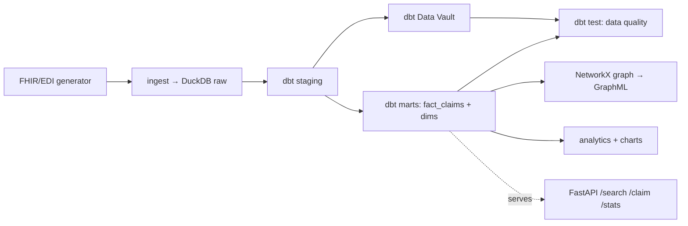

# healthcare-claims-lakehouse

[](https://github.com/bushra-nazeer/healthcare-claims-lakehouse/actions/workflows/ci.yml)


A healthcare claims **lakehouse**, end-to-end on free local tooling: synthetic
**FHIR/EDI** claims → **DuckDB** → a **dbt Data Vault 2.0 + star-schema** warehouse
with **data-quality tests** → a **clinical knowledge graph** → **vector code
search** → a **FastAPI** service.

> Paid infra is mapped to local equivalents with identical interfaces, so the
> whole thing runs at `$0`. Numbers below are from a real `make pipeline` run.

## What one `make pipeline` produces

| Stage | Result |
|---|---|
| Ingest (FHIR → DuckDB) | 25,000 claims · 2,000 patients · 200 providers · 8 payers |
| **dbt run** | **15 models** built (staging → Data Vault → marts) |
| **dbt test** (data quality) | **22/22 passing** (unique, not_null, relationships, accepted_values) |
| Knowledge graph | **27,215 nodes · 75,000 edges** (claims/patients/providers/diagnoses) |
| Vector index | 25 clinical codes (ICD-10 + CPT) |
| Analytics | denial rate **11.7%**, **$4.79M** billed |

| Denial rate by payer | Billed by specialty |
|---|---|
|  |  |

## Local stack ↔ production mapping

| This repo (free, local) | Production equivalent |
|---|---|
| DuckDB | Snowflake / Databricks |
| dbt-duckdb | dbt on Snowflake |
| NetworkX + GraphML | Neo4j / AWS Neptune |
| TF-IDF + cosine NN | Transformer embeddings + Milvus |
| `pipeline.py` runner | Airflow (DAG in `dags/`) |

The dbt models, the graph queries, and the search interface are all
engine-portable, only the backing system changes.

## The warehouse

```
raw (parsed FHIR)  →  staging (typed views)  →  vault (Data Vault 2.0)  →  marts (star schema)
                                                  hub_* / link_* / sat_*    fact_claims + dim_*
```

**Data quality lives in dbt tests** (`dbt test`): primary-key `unique`/`not_null`
on every hub and dimension, `relationships` from `fact_claims` to each dimension,
and `accepted_values` on claim status.

## Architecture



## Quickstart

```bash
docker compose up --build api          # serve the API at http://localhost:8000

make install
make pipeline    # generate → ingest → dbt run → dbt test → graph → vector → analytics
make serve       # FastAPI
make test        # pytest    |    make lint
```

## Using the API

```bash
curl "localhost:8000/stats"
curl "localhost:8000/search?q=diabetes%20blood%20sugar&k=3"
curl "localhost:8000/claim/C1000000"
```

```json
// /search?q=diabetes blood sugar
{"query": "diabetes blood sugar",
 "results": [{"system": "ICD-10", "code": "E11.9",
              "description": "Type 2 diabetes mellitus without complications",
              "score": 0.2495}]}
```

## Repository layout

```
src/claims/   generator (FHIR/EDI) · ingest · graph · vector_search · analytics · pipeline · codes
src/claims/api/   FastAPI /search, /claim/{id}, /stats
dbt/          staging · vault (hubs/links/sats) · marts (fact + dims) + data-quality tests
dags/         Airflow DAG (scheduled production orchestration)
tests/        generator + FHIR round-trip, ingest, vector search, graph, API
```

## License

[MIT](LICENSE)
